<!-- Bannière Capsule Render -->

  

<!-- Texte animé -->

  

 
 

  🚀 <strong>Product Builder &amp; No-Code Developer</strong>
  passionate about creating digital products and scalable SaaS platforms.

 
 
🧩 I build and automate projects using **no-code** and **low-code** tools such as :  
 
 

 
 
💻 I also have hands-on experience in traditional development with :  
 
 

 

  🤝 I’m open to collaborations on tech, automation, and no-code projects
  — especially those related to <strong>peer-to-peer marketplaces</strong>
  and <strong>SaaS innovation</strong>.

 

<h3>🐍 My GitHub contributions</h3>

<picture>
  <source
    media="(prefers-color-scheme: dark)"
    srcset="https://raw.githubusercontent.com/maldonae/maldonae/output/github-snake-dark.svg"
  />
  <source
    media="(prefers-color-scheme: light)"
    srcset="https://raw.githubusercontent.com/maldonae/maldonae/output/github-snake.svg"
  />
  
</picture>

## 📊 GitHub Stats

 

  
  

    

  
  

 
 
## 🔥 Streak Stats
 
 

  

<picture>
  <source 
    srcset="https://github-readme-activity-graph.vercel.app/graph?username=maldonae&theme=dracula&hide_border=true"
    media="(prefers-color-scheme: dark)"
  />
  <source 
    srcset="https://github-readme-activity-graph.vercel.app/graph?username=maldonae&theme=github-light&hide_border=true"
    media="(prefers-color-scheme: light)"
  />
  
</picture>
 
 
## 📫 Contact
 
 

 
 
## 🌐 Portfolio
 
 

 
 

